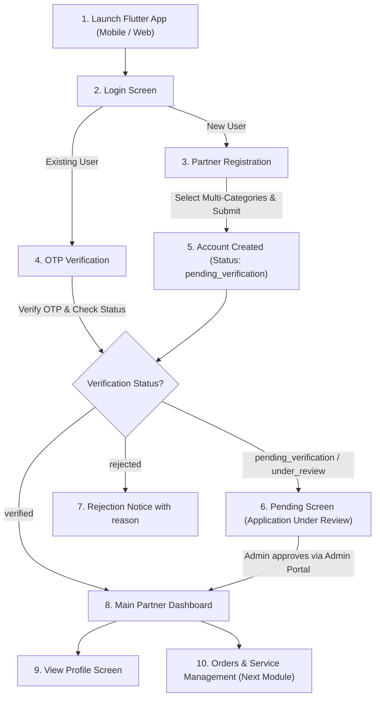

# Cooperative Clap - Service Provider Application
## System Architecture, Folder Structure & Step-by-Step Workflow

---

### 1. Project Overview & Architectural Decision
- **App Name**: Cooperative Clap (Service Provider Partner App)
- **Single UI Codebase Principle**: 
  - **Flutter (`mobile_app/`)** is the **ONLY UI Codebase** for all 3 platforms:
    - 📱 **Android App**
    - 🍏 **iOS App**
    - 🌐 **Web App** (Compiled Flutter Web)
- **Headless Backend**: 
  - **Core PHP** is strictly used as a **Headless REST API** (`backend/api/`) returning JSON data.
  - **No UI / HTML / CSS / JS in PHP**. All frontend presentation logic resides 100% inside Flutter.
- **Database**: MySQL (`cooperative_clap`) accessed via PHP PDO.

---

### 2. Clean Folder Structure (Pure Single UI Codebase)

```text
d:\htdocs\CP-APPP\service-provider/
│
├── index.html                     # Entry point redirecting directly to Flutter Web App
├── .gitignore                     # Git ignore rules
│
├── mobile_app/                    # ⭐ THE SINGLE UI CODEBASE (Flutter Dart)
│   ├── pubspec.yaml               # Dependencies (Dio, Riverpod, etc.)
│   ├── lib/
│   │   ├── main.dart              # Flutter Entry Point (Shared for Web, Android & iOS)
│   │   ├── core/
│   │   │   ├── config/            # AppConfig (Base URL, Environment)
│   │   │   ├── constants/         # Colors, API Endpoints, Strings
│   │   │   └── network/           # ApiClient (Dio HTTP Client with interceptors)
│   │   └── features/
│   │       ├── auth/              # Authentication Feature
│   │       │   └── presentation/
│   │       │       ├── login_screen.dart    # Mobile Login + OTP
│   │       │       ├── otp_screen.dart      # OTP Verification screen
│   │       │       └── register_screen.dart # Partner registration + Multi-select skills
│   │       ├── verification/      # Verification Feature
│   │       │   └── presentation/
│   │       │       └── pending_screen.dart  # Under Review / Pending screen
│   │       ├── dashboard/         # Dashboard Feature
│   │       │   └── presentation/
│   │       │       └── dashboard_screen.dart# Partner Main Dashboard
│   │       └── profile/           # Dedicated Profile Feature
│   │           └── presentation/
│   │               └── profile_screen.dart  # Full Profile view & future actions
│   ├── android/                   # Native Android platform wrapper
│   ├── ios/                       # Native iOS platform wrapper
│   └── web/                       # Flutter Web platform wrapper
│
├── web/                           # Compiled Flutter Web release (Junction to mobile_app/build/web)
│   ├── index.html                 # Flutter Web loader
│   ├── flutter_bootstrap.js
│   └── main.dart.js
│
├── backend/                       # Pure Core PHP REST API (Headless Backend)
│   ├── .env                       # Environment variables (DB credentials, App Config)
│   ├── api/
│   │   └── index.php              # REST API Router & Request Dispatcher (JSON only)
│   ├── app/
│   │   ├── Controllers/
│   │   │   ├── AuthController.php     # Login, Register, Status Check API logic
│   │   │   └── ProviderController.php # Provider Profile & Dashboard API logic
│   │   ├── Models/
│   │   │   └── Provider.php           # Provider DB Model
│   │   └── Helpers/
│   │       └── Response.php           # Standard JSON Response Formatter
│   ├── config/
│   │   ├── app.php                # App level configurations
│   │   └── database.php           # MySQL PDO Connection setup
│   └── database/
│       └── schema.sql             # MySQL Database Tables
│
└── uploads/                       # Partner KYC documents & avatar storage
```

---

### 3. Step-by-Step Application Workflow



#### Detailed Phase Breakdown:

1. **Step 1: First-Time Onboarding & Login**
   - User opens the app (whether on Web browser, Android phone, or iOS).
   - Same Flutter code renders responsive, adaptive design across all screens.
   - Enter mobile number -> Request OTP or click *"Register as Partner"*.

2. **Step 2: Partner Registration**
   - Full Name, Phone Number, Email, City/Work Area, Password.
   - **Multi-select Category Dropdown**: User selects multiple service skills (Electrician, Plumber, AC Repair) with tag chips.
   - Submits payload to PHP REST API (`POST /backend/api/auth/register`).
   - Initial status assigned: `pending_verification`.

3. **Step 3: Verification & Pending State**
   - Registration complete hone par app auto-switches to **Pending Screen**.
   - Clear message: Documents & application are under review by CP Clap administration.

4. **Step 4: Admin Verification & Approval**
   - Separate Admin portal/API updates status in MySQL from `pending_verification` to `verified`.

5. **Step 5: Active Partner Dashboard**
   - Once verified, partner accesses the full dashboard.
   - Branded Header Bar with Profile Icon.
   - Live order / job requests readiness.

6. **Step 6: Dedicated Profile Screen**
   - Profile view showing partner name, phone, email, registered skills, and verification status.

---

### 4. Single UI Codebase Cross-Platform Execution

| Target | Build / Run Command | URL / Output |
| :--- | :--- | :--- |
| **Android Phone / Simulator** | `flutter run -d <device-id>` | Live on Android Simulator & Physical Phone |
| **iOS Phone / Simulator** | `flutter run -d <ios-device-id>` | Live on iOS Device / Simulator |
| **Web Browser** | `flutter build web --release` | `http://localhost/CP-APPP/service-provider/` |
| **Backend REST API** | Core PHP + MySQL | `http://localhost/CP-APPP/service-provider/backend/api/` |
