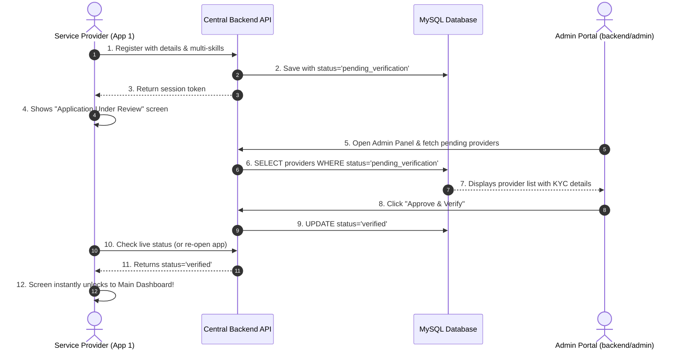

# Cooperative Clap - Ecosystem Architecture, Structure & Workflow
## Centralized Backend, Web Admin Panel & Multi-App Setup

---

### 1. Ecosystem Overview
- **Project Concept**: Urban Company / Clap Ecosystem
- **Centralized Core Backend**: **One single PHP REST API + MySQL Database** powering all 3 mobile apps and the Admin Panel.
- **Admin Panel**: Located inside the backend (`backend/admin/`) to verify service providers, manage categories, and oversee operations.
- **Client Applications (Multi-App Setup)**:
  1. 📱 **App 1: `service-provider/`** (Currently Active — Flutter Dart for Android, iOS & Web)
  2. 🔮 **App 2: `customer-app/`** (Future Customer Booking App)
  3. 🔮 **App 3: `third-app/`** (Future Delivery / Field Operations App)

---

### 2. Complete Folder Structure

```text
d:\htdocs\CP-APPP\service-provider/  (Note: Root project directory, can be renamed anytime)
│
├── index.html                     # Root redirector to Flutter Web App
├── .gitignore                     # Git ignore rules
│
├── backend/                       # 🌐 CENTRALIZED HEADLESS BACKEND (Shared for all 3 apps)
│   ├── admin/                     # 🖥️ CENTRAL WEB ADMIN PANEL
│   │   └── index.php              # Partner KYC verification, approvals & status management
│   ├── api/
│   │   └── index.php              # REST API Router (supports provider, customer, admin actions)
│   ├── app/
│   │   ├── Controllers/
│   │   │   ├── AuthController.php     # OTP & Registration API
│   │   │   └── ProviderController.php # Status, Dashboard & Admin listing/approval API
│   │   ├── Models/
│   │   │   └── Provider.php           # Provider queries (getAll, findByPhone, updateStatus)
│   │   └── Helpers/
│   │       └── Response.php           # Standard REST JSON Response Formatter
│   ├── config/
│   │   ├── app.php                # App environment settings
│   │   └── database.php           # Central MySQL PDO connection
│   └── database/
│       └── schema.sql             # Shared MySQL Schema (`cooperative_clap`)
│
├── service-provider/              # ⭐ APP 1: SERVICE PROVIDER (Flutter Codebase)
│   ├── pubspec.yaml               # Shared dependencies (Dio, Riverpod)
│   ├── lib/
│   │   ├── main.dart              # Single UI entry point (Android, iOS & Web)
│   │   ├── core/
│   │   │   ├── config/            # AppConfig (Base URL, Environment)
│   │   │   ├── constants/         # Colors, Endpoints, Strings
│   │   │   └── network/           # ApiClient (Dio)
│   │   └── features/
│   │       ├── auth/              # Login & Multi-category Partner Registration
│   │       ├── verification/      # Pending Screen ("Application Under Review")
│   │       ├── dashboard/         # Active Partner Dashboard (Unlocked when verified)
│   │       └── profile/           # Dedicated Profile Screen
│   ├── android/                   # Android native wrapper
│   ├── ios/                       # iOS native wrapper
│   └── web/                       # Flutter Web native wrapper
│
├── customer-app/                  # 🔮 APP 2: CUSTOMER APP (To be added)
│
├── third-app/                     # 🔮 APP 3: DELIVERY / FIELD STAFF (To be added)
│
├── web/                           # Compiled Flutter Web release (Junction to service-provider\build\web)
│   ├── index.html                 # Flutter Web production entry
│   ├── flutter_bootstrap.js
│   └── main.dart.js
│
└── uploads/                       # Storage for partner KYC documents & avatars
```

---

### 3. Verification & Approval Workflow



---

### 4. Direct URLs & Access Points

| Component | Technology | URL / Path |
| :--- | :--- | :--- |
| **Central Admin Panel** | Core PHP + Web Dashboard | `http://localhost/CP-APPP/service-provider/backend/admin/` |
| **Central REST API** | Core PHP JSON Router | `http://localhost/CP-APPP/service-provider/backend/api/index.php` |
| **App 1 (Web View)** | Compiled Flutter Web | `http://localhost/CP-APPP/service-provider/` |
| **App 1 (Android Simulator)**| Flutter Android | Running live on `Medium_Phone_API_37.0` |
| **Database** | MySQL | Database: `cooperative_clap` |
